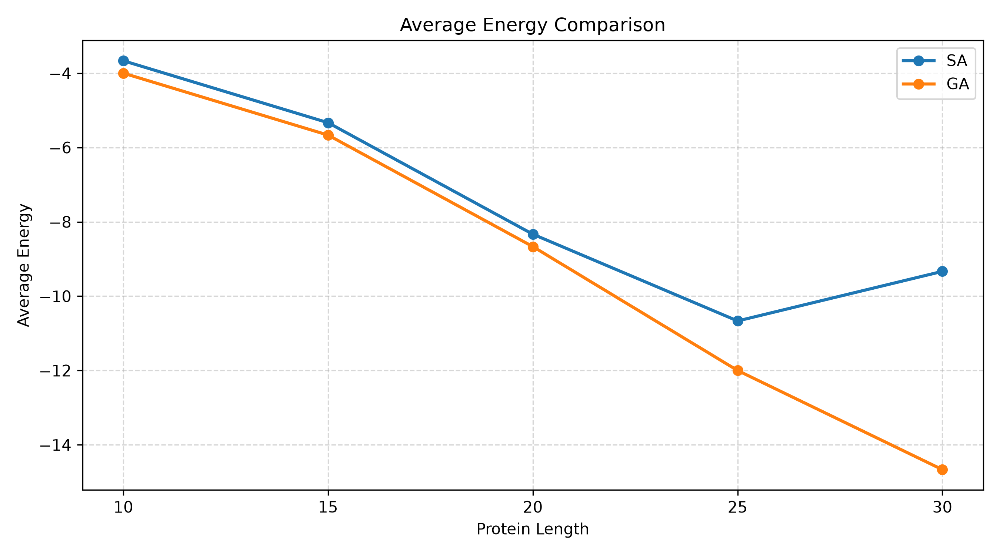

# AI-Based Protein Structure Prediction and Optimization

## 1. Project Overview

This project focuses on predicting and optimizing protein structures using algorithmic search techniques.

The system receives an amino acid sequence and attempts to find a valid and optimized three-dimensional protein structure using the Hydrophobic-Polar (HP) model.

The main objective is to explore different protein configurations, evaluate their quality using an energy function, and compare the performance of two optimization algorithms:

- Simulated Annealing (SA)
- Genetic Algorithm (GA)

The project implements its own algorithms without relying on external protein-folding libraries.

## 2. Project Objectives

The main objectives are:

- Convert an amino acid sequence into a computational representation.
- Represent proteins using a three-dimensional lattice model.
- Implement an energy function for evaluating protein structures.
- Implement two different optimization algorithms.
- Reduce the search space by rejecting invalid and duplicate structures.
- Evaluate the algorithms using proteins of different lengths.
- Compare solution quality, execution time, and memory usage.
- Analyze the time and space complexity of the implemented algorithms.

## 3. Protein Representation

### 3.1 Hydrophobic-Polar Model

The project uses the Hydrophobic-Polar (HP) model to simplify protein representation.

Each amino acid is classified into one of two categories:

- H (Hydrophobic): Amino acids that tend to avoid water.
- P (Polar): Amino acids that interact more favorably with water.

The amino acid sequence is converted into an H/P sequence using the implemented classification.

### 3.2 Three-Dimensional Lattice

The protein is represented as a sequence of residues positioned on a three-dimensional lattice.

Each residue has an integer coordinate:

`(x, y, z)`

The structure must satisfy two conditions:

1. No two residues can occupy the same coordinate.
2. Consecutive residues must be adjacent on the lattice.

These conditions ensure that the generated protein structure is valid according to the implemented model.

## 4. Energy Function

The energy function evaluates the quality of a protein structure.

The implemented function considers non-consecutive hydrophobic contacts.

The energy is calculated as:

**E(S) = -N_HH**

Where:

- E(S) represents the energy of the structure.
- N_HH represents the number of non-consecutive hydrophobic contacts.

Two hydrophobic residues contribute to the energy when they are adjacent in the three-dimensional lattice but are not consecutive in the original amino acid sequence.

A lower energy value indicates a better structure according to the implemented HP model.

## 5. Optimization Algorithms

### 5.1 Simulated Annealing (SA)

Simulated Annealing is a probabilistic optimization algorithm inspired by the physical process of cooling materials.

The algorithm starts with an initial valid protein structure and repeatedly generates neighboring configurations.

A new configuration is accepted when:

- It has lower energy than the current configuration.
- Or it is accepted probabilistically according to the current temperature.

The temperature decreases during the optimization process, reducing the probability of accepting worse solutions.

This allows the algorithm to explore the search space and potentially avoid local optima.

### 5.2 Genetic Algorithm (GA)

The Genetic Algorithm is an optimization technique inspired by natural evolution.

It maintains a population of candidate protein structures and improves them through successive generations.

The main operations include:

- **Initialization:** Generate an initial population of valid structures.
- **Evaluation:** Calculate the energy of each structure.
- **Selection:** Select candidate structures for reproduction.
- **Crossover:** Combine parts of two parent structures.
- **Mutation:** Modify structures to generate new configurations.
- **Elitism:** Preserve high-quality structures for the next generation.

The algorithm aims to improve the quality of the population over successive generations.

## 6. Search-Space Reduction

The protein structure search space grows rapidly as the protein length increases.

The project uses the following techniques to reduce unnecessary exploration:

### Invalid Structure Rejection

Structures containing overlapping residues or invalid connections are rejected.

### Duplicate Elimination

Previously visited structures are identified using coordinate-based signatures.

Duplicate configurations are not evaluated again.

### Energy Caching

The Genetic Algorithm uses energy caching to avoid recalculating the energy of structures that have already been evaluated.

These techniques reduce unnecessary computations and improve search efficiency.

## 7. Local Search and Structure Modification

The algorithms use structure modification operations to explore neighboring configurations.

The implemented operations include:

- End moves.
- Pivot moves.
- Rotations in different coordinate planes.
- Genetic mutations.

Every generated candidate structure is checked to ensure that it satisfies the structural validity constraints.

## 8. System Architecture

The project is organized into the following main components:

```text
Dren-Kelmendi---AI-Based-Protein-Structure-Prediction-and-Optimization/
│
├── algorithms/
│   ├── moves.py
│   ├── simulated_annealing.py
│   ├── genetic_algorithm.py
│   └── search_utils.py
│
├── backend/
│   └── app.py
│
├── evaluation/
│   ├── energy.py
│   └── metrics.py
│
├── experiments/
│   ├── benchmark.py
│   ├── benchmark_results.csv
│   ├── plot_results.py
│   ├── energy_comparison.png
│   ├── time_comparison.png
│   └── memory_comparison.png
│
├── protein/
│   └── representation/
│       ├── sequence.py
│       ├── hp_model.py
│       ├── structure.py
│       └── constraints.py
│
├── frontend/
│   ├── public/
│   └── src/
│       ├── components/
│       │   ├── ProteinViewer.jsx
│       │   └── EnergyChart.jsx
│       ├── App.jsx
│       ├── App.css
│       ├── index.css
│       └── main.jsx
│
├── tests/
│   ├── test_energy.py
│   ├── test_representation.py
│   ├── test_simulated_annealing.py
│   └── test_genetic_algorithm.py
│
├── main.py
├── README.md
└── requirements.txt
```

## 9. Technologies Used

### Backend
- Python
- FastAPI
- Pydantic

### Frontend
- React
- JavaScript
- Three.js
- Vite

### Algorithms and Evaluation
- Simulated Annealing
- Genetic Algorithm
- HP Protein Model
- Matplotlib
- Python unittest
- Tracemalloc

## 10. Performance Evaluation

The algorithms are evaluated using proteins of different lengths.

The experiments compare:

- Average energy.
- Average execution time.
- Average memory consumption.

Each protein length is tested three times, and the average results are calculated.

### 10.1 Experimental Configuration

| Parameter | Value |
|---|---:|
| Protein lengths | 10, 15, 20, 25, 30 |
| Number of runs | 3 |
| SA iterations | 3000 |
| GA population size | 30 |
| GA generations | 100 |

### 10.2 Benchmark Results

The following table presents the measured average results.

| Length | Algorithm | Average Energy | Time (s) | Memory (MB) |
|---:|---|---:|---:|---:|
| 10 | SA | -3.67 | 0.4656 | 0.4359 |
| 10 | GA | -4.00 | 1.2234 | 1.7747 |
| 15 | SA | -5.33 | 0.5932 | 1.1694 |
| 15 | GA | -5.67 | 1.1399 | 2.4097 |
| 20 | SA | -8.33 | 0.7546 | 1.6453 |
| 20 | GA | -8.67 | 1.4234 | 3.2088 |
| 25 | SA | -10.67 | 0.8594 | 1.5469 |
| 25 | GA | -12.00 | 1.8002 | 4.3235 |
| 30 | SA | -9.33 | 1.0923 | 2.3621 |
| 30 | GA | -14.67 | 2.1278 | 5.1165 |

### 10.3 Experimental Graphs

#### Average Energy Comparison



#### Execution Time Comparison


#### Memory Usage Comparison


### 10.4 Results Analysis

**Solution Quality**

The Genetic Algorithm achieved lower average energy values than Simulated Annealing for all tested protein lengths.

This indicates that GA found structures with more favorable hydrophobic contacts in these experiments.

**Execution Time**

Simulated Annealing was faster in all tested cases.

The Genetic Algorithm required more computation time because it evaluates and evolves a population of candidate structures.

**Memory Usage**

Simulated Annealing used less memory than the Genetic Algorithm in all experiments.

The Genetic Algorithm requires additional memory for maintaining its population and associated search information.

**Scalability**

As protein length increases, both algorithms generally require more computational resources.

The results demonstrate a trade-off between solution quality and computational efficiency.

## 11. Time and Space Complexity Analysis

Let:

- n = protein length.
- I = number of Simulated Annealing iterations.
- G = number of Genetic Algorithm generations.
- P = population size.
- U = number of unique structures stored during the search.

### Energy Function

The energy function compares residue pairs to identify hydrophobic contacts.

**Time Complexity:** O(n²)

**Auxiliary Space Complexity:** O(1)

### Structure Validation

Overlap detection uses coordinate-based set operations, while connection validation checks consecutive residues.

**Expected Time Complexity:** O(n)

**Space Complexity:** O(n)

### Simulated Annealing

The algorithm performs I iterations. Each iteration generates and evaluates a neighboring structure.

Since energy evaluation takes O(n²):

**Time Complexity:** O(I × n²)

The algorithm stores visited structures and their coordinate signatures.

**Space Complexity:** O(I × n)

### Genetic Algorithm

The Genetic Algorithm processes a population of P structures over G generations.

Assuming approximately P candidate evaluations per generation and an O(n²) energy evaluation:

**Typical Time Complexity:** O(G × P × n²)

The algorithm stores its population and cached or visited structures.

**Space Complexity:** O(U × n + P × n)

The actual running time depends on the number of valid and unique candidate structures generated.

## 12. Testing

The project includes automated unit tests using Python's unittest framework.

The tests cover:

- Protein sequence validation.
- Amino acid conversion.
- Initial protein structure generation.
- Structure overlap detection.
- Connection validation.
- Energy calculation.
- Simulated Annealing behavior.
- Genetic Algorithm behavior.

### Running Tests

From the project root directory, execute:

```bash
python -m unittest discover -s tests -v
```

**Current test result:**

25 tests passed successfully.

## 13. Installation and Execution

### 13.1 Clone the Repository

```bash
git clone https://github.com/drenkelmendi02/Dren-Kelmendi---AI-Based-Protein-Structure-Prediction-and-Optimization.git
```

### 13.2 Enter the Project Directory

```bash
cd Dren-Kelmendi---AI-Based-Protein-Structure-Prediction-and-Optimization
```

### 13.3 Install Python Dependencies

```bash
pip install -r requirements.txt
```

### 13.4 Run the Backend

```bash
uvicorn backend.app:app --reload
```

### 13.5 Run the Frontend

Open another terminal:

```bash
cd frontend
npm install
npm run dev
```

### 13.6 Run the Benchmark

From the project root directory:

```bash
python -m experiments.benchmark
```

### 13.7 Generate Experimental Graphs

```bash
pip install matplotlib
python -m experiments.plot_results
```

## 14. Limitations

- The project uses the simplified Hydrophobic-Polar model.
- Protein structures are represented on a three-dimensional lattice.
- The energy function considers non-consecutive hydrophobic contacts.
- The predicted structures are approximations within the implemented model.
- The results do not represent experimentally verified biological protein structures.

## 15. Conclusion

This project demonstrates how algorithmic optimization techniques can be applied to simplified protein structure prediction.

Two different optimization approaches, Simulated Annealing and Genetic Algorithm, were implemented and evaluated.

Experimental results show that the Genetic Algorithm achieved better energy values in the tested cases, while Simulated Annealing required less execution time and memory.

The project demonstrates the importance of balancing solution quality, computational efficiency, and search-space reduction when solving complex optimization problems.

---

**Repository:**  
https://github.com/drenkelmendi02/Dren-Kelmendi---AI-Based-Protein-Structure-Prediction-and-Optimization/
