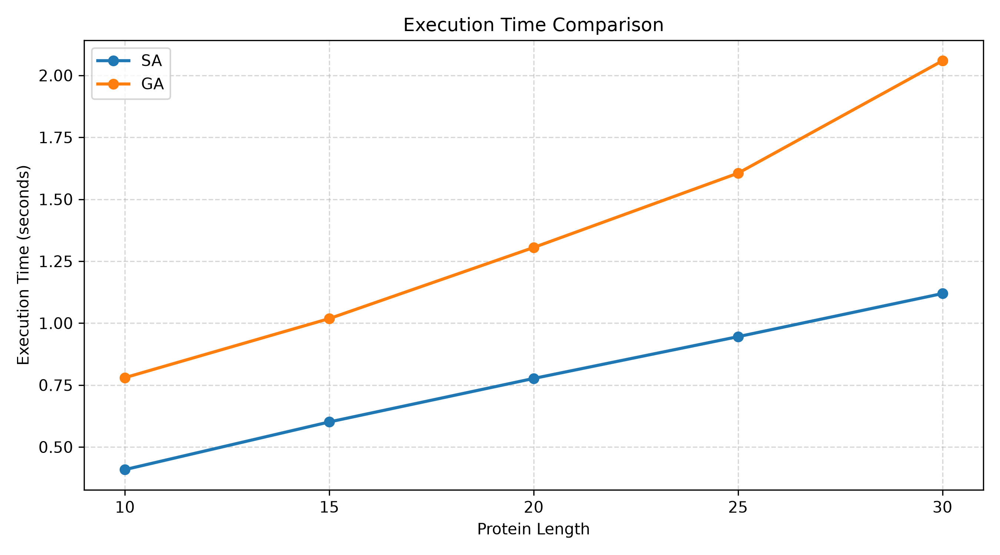
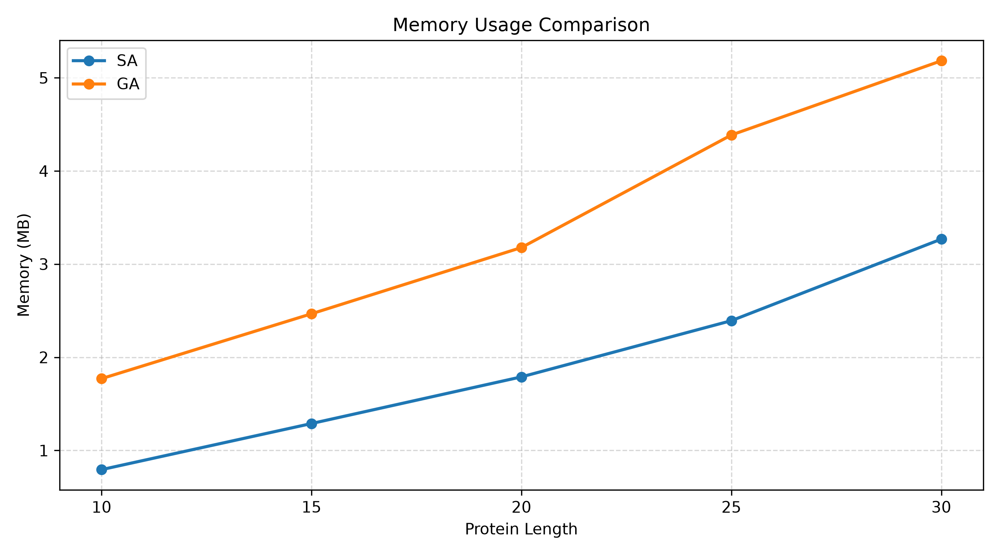
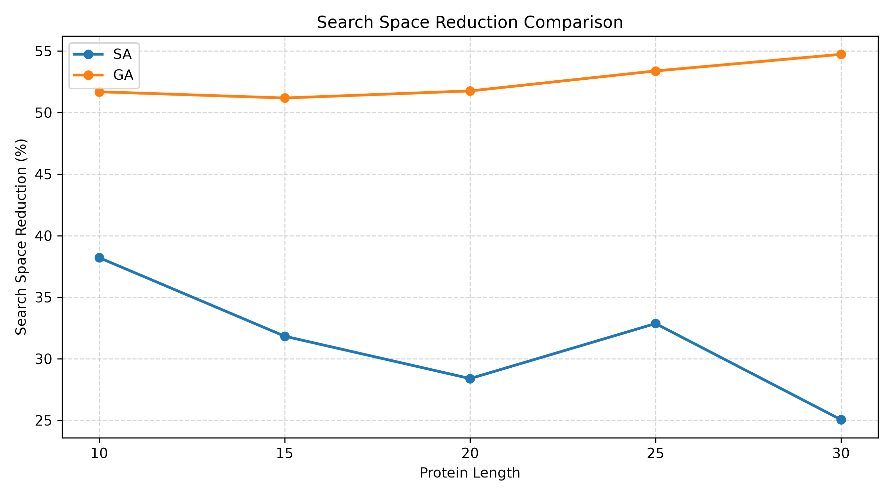

# AI-Based Protein Structure Prediction and Optimization

## 1. Project Overview

This project focuses on predicting and optimizing protein structures using algorithmic search and optimization techniques.

The system receives an amino acid sequence and attempts to find a valid and optimized three-dimensional protein structure using the Hydrophobic-Polar (HP) model.

The main objective is to explore different protein configurations, evaluate their quality using an energy function, and compare the performance of two optimization algorithms:

- Simulated Annealing (SA)
- Genetic Algorithm (GA)

The project implements its own optimization algorithms without relying on external protein-folding libraries.

## 2. Project Objectives

The main objectives of this project are:

- Convert an amino acid sequence into a computational representation.
- Represent proteins using a three-dimensional lattice model.
- Implement an energy function for evaluating protein structures.
- Implement two different optimization algorithms.
- Apply search-space reduction techniques.
- Generate and validate different protein configurations.
- Evaluate the algorithms using proteins of different lengths and sequence patterns.
- Compare solution quality, execution time, and memory consumption.
- Visualize the resulting protein structures in 3D.
- Analyze the experimental results and algorithm performance.

## 3. Protein Representation

### 3.1 Hydrophobic-Polar Model

The project uses the Hydrophobic-Polar (HP) model to simplify protein representation.

Each amino acid is classified into one of two categories:

- **H (Hydrophobic):** Amino acids that tend to avoid water.
- **P (Polar):** Amino acids that interact more favorably with water.

The original amino acid sequence is converted into an H/P sequence using the implemented classification.

This representation simplifies the protein-folding problem and allows the optimization algorithms to work with a reduced model.

### 3.2 Three-Dimensional Lattice

The protein is represented as a sequence of residues positioned on a three-dimensional lattice.

Each residue has an integer coordinate:

`(x, y, z)`

A valid protein structure must satisfy two conditions:

1. No two residues can occupy the same coordinate.
2. Consecutive residues must be adjacent on the lattice.

These constraints ensure that generated protein structures are valid according to the implemented HP model.

## 4. Energy Function

The energy function evaluates the quality of a protein structure using non-consecutive hydrophobic contacts.

The implemented energy function is:

**E(S) = -w × N_HH**

Where:

- **E(S)** represents the energy of the protein structure.
- **w** represents the configurable hydrophobic contact weight.
- **N_HH** represents the number of non-consecutive hydrophobic contacts.

A hydrophobic contact is counted when two hydrophobic residues (H) are adjacent in the three-dimensional lattice but are not consecutive in the original amino acid sequence.

The hydrophobic contact weight is configurable through the `hydrophobic_contact_weight` parameter. Its default value is 1.0.

A lower (more negative) energy value indicates a better structure according to the implemented HP model.

## 5. Optimization Algorithms

### 5.1 Simulated Annealing (SA)

Simulated Annealing is a probabilistic optimization algorithm inspired by the physical process of cooling materials.

The algorithm starts with an initial valid protein structure and repeatedly generates neighboring configurations.

A new configuration is accepted when:

- It has lower energy than the current configuration.
- Or it is accepted probabilistically according to the current temperature.

The temperature decreases during the optimization process, reducing the probability of accepting worse solutions.

This mechanism allows the algorithm to explore different configurations and potentially avoid local optima.

The algorithm keeps track of the best structure found during the optimization process.

### 5.2 Genetic Algorithm (GA)

The Genetic Algorithm is an optimization technique inspired by natural evolution.

It maintains a population of candidate protein structures and improves them through successive generations.

The main operations include:

- **Initialization:** Generate an initial population of valid structures.
- **Evaluation:** Calculate the energy of each structure.
- **Selection:** Select candidate structures for reproduction.
- **Crossover:** Combine parts of parent structures to generate new candidates.
- **Mutation:** Modify structures to explore new configurations.
- **Elitism:** Preserve high-quality structures for the next generation.

The algorithm aims to improve the quality of the population over successive generations.

It also uses energy caching to avoid unnecessary repeated energy calculations.

## 6. Search-Space Reduction

The protein structure search space grows rapidly as the protein length increases.

The project uses several techniques to reduce unnecessary exploration and computational work.

### 6.1 Invalid Structure Rejection

Structures containing overlapping residues or invalid connections are rejected.

This prevents the algorithms from continuing to evaluate configurations that do not satisfy the structural constraints.

### 6.2 Duplicate Elimination

Previously visited structures are identified using coordinate-based signatures.

Duplicate configurations are not evaluated again, reducing repeated work.

### 6.3 Energy Caching

The Genetic Algorithm uses an energy cache to store previously calculated energy values.

When a known structure is encountered again, its stored energy value can be reused instead of recalculated.

These techniques reduce unnecessary computations and improve search efficiency.

## 7. Local Search and Structure Modification

The algorithms use structure modification operations to explore neighboring configurations.

The implemented operations include:

- End moves.
- Pivot moves.
- Rotations in different coordinate planes.
- Genetic mutations.

Every generated candidate structure is checked to ensure that it satisfies the structural validity constraints.

These operations allow the algorithms to explore different configurations while preserving the required protein structure rules.

## 8. System Architecture

The project is organized into the following main components:

```text
Dren-Kelmendi---AI-Based-Protein-Structure-Prediction-and-Optimization/
│
├── algorithms/
│   ├── moves.py
│   ├── simulated_annealing.py
│   ├── genetic_algorithm.py
│   └── search_utils.py
│
├── backend/
│   └── app.py
│
├── evaluation/
│   ├── energy.py
│   └── metrics.py
│
├── experiments/
│   ├── benchmark.py
│   ├── benchmark_results.csv
│   ├── plot_results.py
│   ├── energy_comparison.png
│   ├── time_comparison.png
│   ├── memory_comparison.png
│   └── search_space_reduction.png
│
├── protein/
│   └── representation/
│       ├── sequence.py
│       ├── hp_model.py
│       ├── structure.py
│       └── constraints.py
│
├── frontend/
│   ├── public/
│   └── src/
│       ├── components/
│       │   ├── ProteinViewer.jsx
│       │   └── EnergyChart.jsx
│       ├── App.jsx
│       ├── App.css
│       ├── index.css
│       └── main.jsx
│
├── tests/
│   ├── test_energy.py
│   ├── test_representation.py
│   ├── test_simulated_annealing.py
│   └── test_genetic_algorithm.py
│
├── main.py
├── README.md
└── requirements.txt
```

## 9. Technologies Used

### Backend
- Python
- FastAPI
- Pydantic

### Frontend
- React
- JavaScript
- Three.js
- Vite

### Algorithms and Evaluation
- Simulated Annealing
- Genetic Algorithm
- Hydrophobic-Polar Protein Model
- Matplotlib
- Python unittest
- Tracemalloc

## 10. Performance Evaluation

The algorithms are evaluated using proteins of different lengths and sequence patterns.

The experiments compare:

- Average energy.
- Average execution time.
- Average memory consumption.
- Search-space reduction.

Each combination of protein length, sequence pattern, and algorithm is tested three times. Average values are calculated to provide a more representative comparison.

### 10.1 Experimental Configuration

| Parameter | Value |
|---|---:|
| Protein lengths | 10, 15, 20, 25, 30 |
| Sequence patterns | 4 |
| Number of runs per configuration | 3 |
| SA iterations | 3000 |
| GA population size | 30 |
| GA generations | 100 |
| Hydrophobic contact weight | 1.0 |

The four sequence patterns used in the experiments are:

- Balanced
- Hydrophobic-rich
- Polar-rich
- Alternating

The benchmark performs 120 algorithm executions in total:

5 protein lengths × 4 sequence patterns × 3 runs × 2 algorithms.

### 10.2 Benchmark Results

The following table presents the average results grouped by protein length and algorithm. The values are averaged across the four sequence patterns.

| Length | Algorithm | Average Energy | Time (s) | Memory (MB) |
|---:|---|---:|---:|---:|
| 10 | SA | -1.92 | 0.409 | 0.794 |
| 10 | GA | -2.00 | 0.780 | 1.771 |
| 15 | SA | -3.58 | 0.601 | 1.289 |
| 15 | GA | -3.92 | 1.018 | 2.467 |
| 20 | SA | -5.67 | 0.777 | 1.790 |
| 20 | GA | -6.34 | 1.305 | 3.178 |
| 25 | SA | -7.59 | 0.945 | 2.393 |
| 25 | GA | -8.17 | 1.605 | 4.386 |
| 30 | SA | -7.67 | 1.119 | 3.269 |
| 30 | GA | -10.17 | 2.059 | 5.183 |

### 10.3 Experimental Graphs

The project generates four graphs to visualize and compare the experimental results.

#### Average Energy Comparison

This graph compares the average energy values obtained by Simulated Annealing and Genetic Algorithm for different protein lengths.


#### Execution Time Comparison

This graph compares the average execution time of both algorithms.



#### Memory Usage Comparison

This graph compares the average memory consumption of both algorithms.



#### Search-Space Reduction Comparison

This graph compares the average percentage of generated candidate structures rejected because they are invalid or duplicates.



### 10.4 Results Analysis

**Solution Quality**

The Genetic Algorithm achieved lower average energy values than Simulated Annealing for all tested protein lengths.

This indicates that GA found structures with more favorable hydrophobic contacts in these experiments.

**Execution Time**

Simulated Annealing was faster than Genetic Algorithm in all tested protein lengths.

The Genetic Algorithm required more computation time because it evaluates and evolves a population of candidate structures.

**Memory Usage**

Simulated Annealing used less memory than Genetic Algorithm in all tested cases.

The Genetic Algorithm requires additional memory for maintaining its population and associated search information.

**Search-Space Reduction**

Both algorithms use invalid structure rejection and duplicate elimination to reduce unnecessary exploration.

The Genetic Algorithm also uses energy caching to avoid repeated energy calculations.

The measured elimination percentage represents the proportion of generated candidate structures rejected due to invalidity or duplication. It does not represent the percentage of the entire theoretical protein configuration space.

**Scalability**

As protein length increases, both algorithms generally require more computational resources.

The results demonstrate a trade-off between solution quality and computational efficiency.

In these experiments, Genetic Algorithm achieved better energy values, while Simulated Annealing provided faster execution and lower memory consumption.

## 11. Testing

The project includes automated unit tests using Python's unittest framework.

The tests cover:

- Protein sequence validation.
- Amino acid conversion.
- Initial protein structure generation.
- Structure overlap detection.
- Connection validation.
- Energy calculation.
- Simulated Annealing behavior.
- Genetic Algorithm behavior.
- Algorithm statistics.
- Custom hydrophobic contact weight.
- Energy history behavior.

### Running Tests

From the project root directory, execute:

```bash
python -m unittest discover -s tests -v
```

**Latest test result:**

26 tests passed successfully.

## 12. Installation and Execution

### 12.1 Clone the Repository

```bash
git clone https://github.com/drenkelmendi02/Dren-Kelmendi---AI-Based-Protein-Structure-Prediction-and-Optimization.git
```

### 12.2 Enter the Project Directory

```bash
cd Dren-Kelmendi---AI-Based-Protein-Structure-Prediction-and-Optimization
```

### 12.3 Install Python Dependencies

```bash
pip install -r requirements.txt
```

Matplotlib is required for generating the experimental graphs:

```bash
pip install matplotlib
```

### 12.4 Run the Backend

```bash
uvicorn backend.app:app --reload
```

### 12.5 Run the Frontend

Open another terminal:

```bash
cd frontend
npm install
npm run dev
```

### 12.6 Run the Benchmark

From the project root directory:

```bash
python -m experiments.benchmark
```

### 12.7 Generate Experimental Graphs

```bash
python -m experiments.plot_results
```

## 13. Limitations

- The project uses the simplified Hydrophobic-Polar model.
- Protein structures are represented on a three-dimensional lattice.
- The energy function considers non-consecutive hydrophobic contacts.
- The predicted structures are approximations within the implemented model.
- The results do not represent experimentally verified biological protein structures.

## 14. Conclusion

This project demonstrates how algorithmic optimization techniques can be applied to simplified protein structure prediction.

Two different optimization approaches, Simulated Annealing and Genetic Algorithm, were implemented and evaluated using a three-dimensional HP protein model.

Experimental results show that the Genetic Algorithm achieved better energy values in the tested cases, while Simulated Annealing required less execution time and memory.

The project also demonstrates the importance of search-space reduction, structural validation, and performance evaluation when solving complex optimization problems.

The final implementation provides protein representation, optimization algorithms, experimental benchmarking, automated testing, and three-dimensional visualization.

---

**Repository:**

https://github.com/drenkelmendi02/Dren-Kelmendi---AI-Based-Protein-Structure-Prediction-and-Optimization/